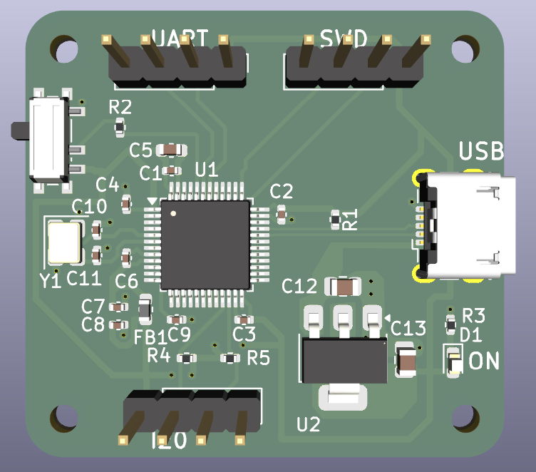
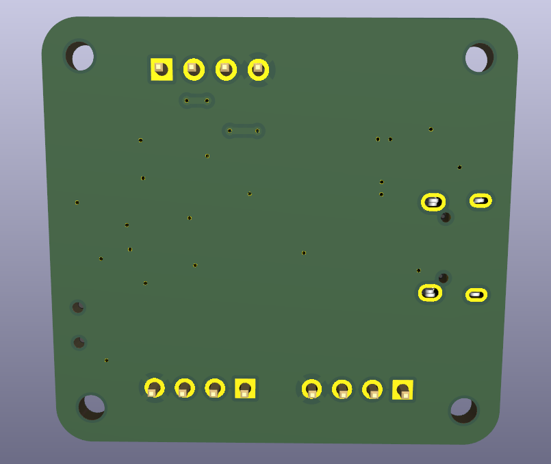
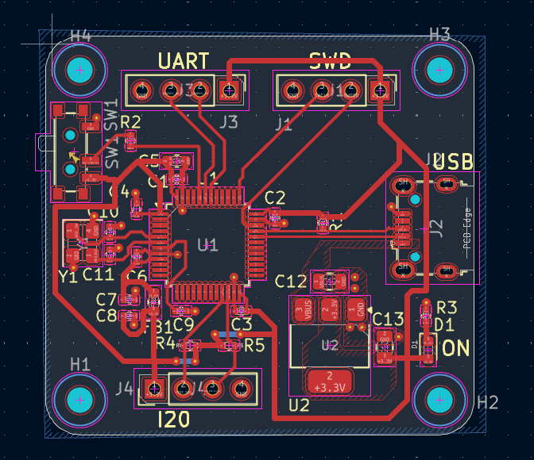
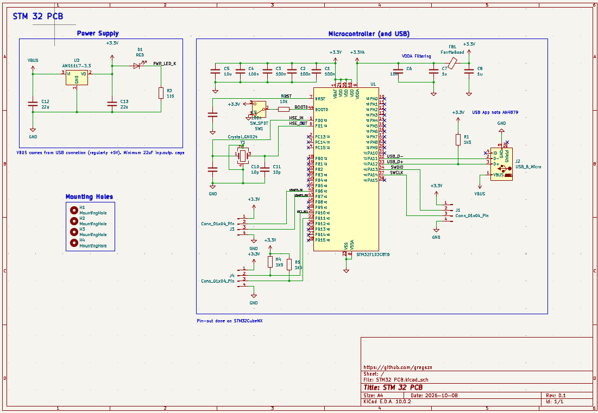

# STM32 Microcontroller PCB Design

A custom two-layer STM32 microcontroller PCB designed in **KiCad 10**, featuring USB connectivity, 3.3V power regulation, SWD programming/debugging, and peripheral interfaces.

This project focuses on schematic capture, PCB layout, component placement, signal routing, power distribution, and design rule verification.

## 3D PCB Model

**Front View**

**Back View**

## PCB Layout

The two-layer PCB incorporates:
- Front-layer signal and power routing
- Copper pours and vias for ground and power connectivity
- Component placement and routing around the STM32 microcontroller
- USB, UART, SWD, and GPIO connections
- Four mounting holes for mechanical integration

## Circuit Schematic

The schematic includes the microcontroller, power regulation, clock circuitry, USB interface, programming/debugging connections, and supporting passive components.

## Hardware Features

| Component | Description |
|---|---|
| Microcontroller | STM32G431 ARM Cortex-M4 |
| Voltage Regulator | AMS1117-3.3 linear regulator |
| USB Interface | USB connector with D+ and D− signal connections |
| Debugging | SWD programming and debugging interface |
| Clock | External crystal oscillator |
| User Controls | BOOT selection switch and reset circuitry |
| Indicators | Power LED |
| Expansion | UART, SWD, and GPIO header connections |
| PCB | Two-layer PCB designed in KiCad |

## Design Process

1. **Schematic Design:** Created the circuit schematic, including power regulation, clock circuitry, USB connections, and microcontroller peripherals.
2. **Component Selection:** Assigned component footprints and integrated 3D models for mechanical visualization.
3. **PCB Layout:** Arranged components to support efficient routing and accessible connectors.
4. **Signal Routing:** Routed power, ground, USB, and peripheral signals across two copper layers.
5. **Copper Zones:** Implemented copper fills and vias to establish electrical connectivity.
6. **Design Verification:** Used KiCad's Design Rules Checker (DRC) to identify and resolve clearance violations, via sizing issues, and unconnected nets.

## Tools & Skills

- KiCad 10
- Schematic Capture
- PCB Layout and Routing
- STM32 Microcontrollers
- Power Distribution
- USB and UART Interfaces
- SWD Debugging
- Design Rule Checking (DRC)
- 3D PCB Visualization

## Project Files

- `STM32 PCB.kicad_pro` — KiCad project configuration
- `STM32 PCB.kicad_sch` — Circuit schematic
- `STM32 PCB.kicad_pcb` — PCB layout
- `images/` — PCB renders, layout, and schematic images

## Project Status

**Schematic and PCB layout completed.**

The PCB has been routed and checked using KiCad's DRC, with no electrical clearance errors or unconnected items reported in the final routing check.

Physical fabrication, assembly, and hardware validation have not yet been performed.

## Acknowledgments

This project was developed as a tutorial-guided PCB design exercise based on **Phil's Lab — KiCad 6 STM32 PCB Design Full Tutorial (#65)**.

The tutorial served as a reference for the circuit architecture, schematic design, component placement, and PCB development workflow.

Tutorial: https://www.youtube.com/watch?v=aVUqaB0IMh4

## License

This repository is licensed under the MIT License. See [LICENSE](LICENSE) for details.
